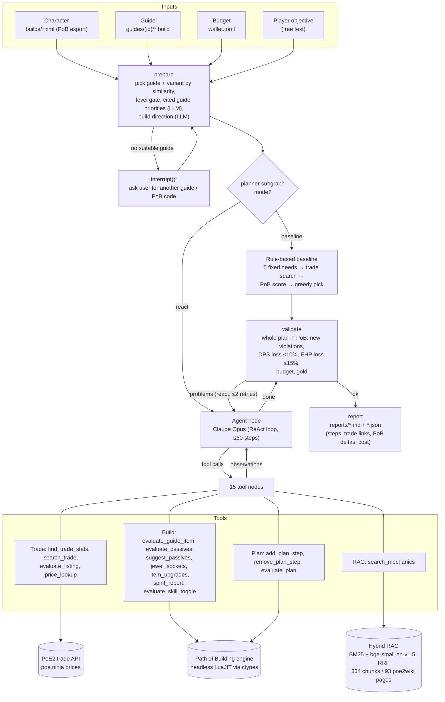

# PoE2 Build Planner Agent

A ReAct agent (Claude + LangGraph) that compares a **Path of Exile 2** character with a guide build and
produces an upgrade plan within the player's budget: what to buy on the trade site, which passives to respec,
which skills to disable to free Spirit, which jewels/runes/quality to add, and which ascendancy to take next.
**Every recommendation is measured with the Path of Building (PoB) engine before it enters the plan**, so the
numbers in the report come from PoB, the official trade site or poe.ninja, never from the model.

Final project for the Natural Language Processing course (Master's in AI, USFQ). Topics: tool-using agents
and agentic RAG on LangGraph. Spanish version: [README.es.md](README.es.md).

## Architecture



Key pieces (`planner/`):

| Module | Role |
|---|---|
| `graph.py` | LangGraph graph: `prepare → planner (baseline \| ReAct agent + tool nodes) → validate → report`, with `interrupt()` for human-in-the-loop guide selection |
| `agent_tools.py` | The 15 tools and the per-run session (plan state, budget, PoB deltas) |
| `pob_engine.py` | Runs Path of Building headless: loads its LuaJIT runtime with `ctypes` and evaluates build XML |
| `pob_xml.py`, `build_file.py`, `pob_code.py`, `tree.py` | Parse PoB XML, guide `.build` files, PoB codes / pobb.in, and the passive tree |
| `trade.py`, `prices.py`, `net.py` | PoE2 trade API search, poe.ninja prices, rate-limited cached HTTP |
| `kb.py` | RAG: poe2wiki fetch, chunking, BM25 + dense embeddings fused with reciprocal rank fusion |
| `guides.py`, `priorities.py`, `direction.py` | Guide import/loading, LLM extraction of cited priorities and build direction |
| `baseline.py` | Rule-based planner without LLM (the comparison baseline) |
| `analysis.py`, `upgrades.py`, `runes.py`, `itemdata.py`, `skilldata.py` | Build analysis, item/rune/quality upgrades, PoB item and skill data |
| `llm.py`, `summary.py`, `wallet.py` | Claude client + token/USD meter, build summary CLI, wallet loader |

All code is also embedded in [`proyecto_final.ipynb`](proyecto_final.ipynb) as `%%writefile` cells (the notebook
is the course deliverable: problem, data, experiment, evaluation and conclusions, in Spanish). The files in
`planner/` and `tests/` are identical to those cells.

## Setup

Requirements: **Windows** (PoB ships a Windows LuaJIT build that the engine loads directly; on Linux/macOS you
need LuaJIT + PoB's Lua modules and to point `pob_engine.py` at `libluajit-5.1.so`/`.dylib`), Python ≥ 3.11, git.

```bash
git clone https://github.com/Ericson3100/poe2-build-planner-agent.git
cd poe2-build-planner-agent
python -m venv .venv && .venv\Scripts\activate
pip install -r requirements.txt          # add -r requirements-dev.txt for RAGAS + pytest
cp .env.example .env                     # put your ANTHROPIC_API_KEY (optional: without it only the baseline runs)
cp wallet.example.toml wallet.toml       # your league, gold and currency (PoE2 has no stash/gold API)
```

Path of Building Community PoE2 (~750 MB) is cloned into `vendor/` by the notebook on first run (pinned commit
`7d6f530cbd`), or manually:

```bash
mkdir -p vendor/PathOfBuilding-PoE2 && cd vendor/PathOfBuilding-PoE2
git init && git remote add origin https://github.com/PathOfBuildingCommunity/PathOfBuilding-PoE2.git
git fetch --depth 1 origin 7d6f530cbdab20389ff8bc6ba97a37ac27f74e41 && git checkout FETCH_HEAD
```

## Usage

1. Export your character from Path of Building and save the XML in `builds/` (an example, `poe2.2.xml`, a
   level-81 Stormweaver, is included).
2. Open `proyecto_final.ipynb` and run all cells. Parameters are in section 5: `BUILD`, `GUIDE`
   (`None` = most similar guide), `GUIDE_SOURCES` (add guides from a `.build`/zip/PoB code/pobb.in/URL),
   `OBJECTIVE` (free-text preference, e.g. "more damage even if defence drops a bit"), `RESIST_FLOOR`.
3. The report is written to `reports/<date>_<build>_<guide>_<mode>.md` plus a `.json` with the metrics.

Other entry points:

```bash
python -m planner.summary builds/poe2.2.xml --wallet wallet.example.toml   # build summary
python -m planner.kb build            # rebuild the RAG index (--refresh re-downloads the wiki)
python -m tests.kb_eval               # retrieval evaluation (no API key needed)
python -m tests.rag_ragas             # RAGAS evaluation (needs ANTHROPIC_API_KEY; shows cached results if present)
python -m pytest -q                   # offline smoke tests
```

`PLANNER_MODE=baseline|react` selects the planner; the notebook runs both.

## Results

One character (`poe2.2`, Stormweaver level 81), guide `coc-comet-animeprincess` (variant `basic`, chosen
automatically by similarity), budget 2,897 ex, same market snapshot. From
[`reports/2026-10-15_*`](reports/):

| Metric | Baseline (rules, no LLM) | ReAct agent (Claude Opus 5.5) |
|---|---|---|
| BuildDPS change | −2.6% | **+6.8%** |
| EHP change | +2.2% | **+18.7%** |
| Energy Shield change | +0.0% | **+43.9%** |
| Initial problems resolved (Str below requirement, Spirit over-reserved) | 2 / 2 | 2 / 2 |
| Valid plan / task solved | yes | yes |
| Plan steps | 2 | 10 |
| Spend (ex / gold) | 1 / 11,135 | 109 / 68,556 |
| Wall time | 219 s | 1,252 s |
| LLM calls / tokens in / out | 0 | 54 / 3,298,340 / 32,201 |
| LLM cost | $0.00 | $1.88 |
| Trade searches / PoB evaluations | 17 / 317 | 20 / 445 |

Both solve the measurable problems. The baseline freed Spirit by disabling the skill PoB says costs nothing
(Mana Remnants), but PoB does not model event-based effects and that skill sustains the build's mana; the agent
reasoned about what each skill does, disabled Convalescence instead, and also proposed a respec, a better jewel,
helmet rune/quality, next passive points and the next ascendancy.

### RAG evaluation

Corpus: 334 chunks from 93 poe2wiki pages + 1 curated note. Retrieval on 28 labelled questions (12 literal,
8 paraphrased, 8 Spanish), averages over all questions (`python -m tests.kb_eval`, reproduced locally):

| Mode | Recall@5 page | Recall@5 passage | MRR passage |
|---|---|---|---|
| BM25 | 0.50 | 0.42 | 0.39 |
| Dense (bge-small-en-v1.5) | **0.79** | 0.54 | 0.47 |
| Hybrid (RRF) | 0.75 | 0.54 | 0.47 |

Answer quality with RAGAS 0.4.3 on 12 questions × 3 modes (generator Claude Haiku 5.5 with the top-5
passages, judge Claude Sonnet 5.5; `reference_coverage` is a custom metric; judge cost $1.03), from
[`reports/rag_ragas.json`](reports/rag_ragas.json):

| Mode | answer_correctness | faithfulness | reference_coverage |
|---|---|---|---|
| BM25 | 0.53 | 0.85 | 0.49 |
| Dense | **0.63** | **0.92** | **0.67** |
| Hybrid | 0.58 | 0.85 | 0.53 |

Literal questions score ≥ 0.85 answer correctness in every mode; Spanish questions are the weak spot
(0.28–0.37), since the embedding model and corpus are English. Hybrid search was not clearly better than dense.

## Limitations

- Single character, class and guide: the comparison does not establish generality across builds.
- "Task solved" only checks plan validity and that the initial problems are fixed; quality is judged through
  DPS/EHP deltas, which do not capture everything a player values.
- PoB does not measure event-based effects (Remnants, infusions, flasks, charms); there the decision rests on
  the LLM's reasoning and the baseline is blind.
- The trade market changes, so reruns find different items and prices; the trade API is undocumented and
  rate-limited.
- PoE2 has no stash/gold API: the budget is entered manually in `wallet.toml`.
- The RAG evaluation set is small (28 retrieval / 12 RAGAS questions).
- The PoB engine integration is Windows-only as shipped.

## Repository layout

```
planner/        agent, tools, PoB engine bridge, RAG, trade, baseline
tests/          offline smoke tests, retrieval eval (kb_eval.py), RAGAS eval (rag_ragas.py)
builds/         example PoB character exports
guides/         guide variants (.build) + source URLs  — see guides/README.md
data/           passive tree + RAG index (poe2wiki, CC BY-NC-SA 3.0) — see data/README.md
reports/        final run reports (agent + baseline) and RAGAS results
proyecto_final.ipynb   full project notebook (Spanish), with outputs
```

## Credits and licenses

- Code: [MIT](LICENSE) © Ericson López.
- [Path of Building Community PoE2](https://github.com/PathOfBuildingCommunity/PathOfBuilding-PoE2) (MIT):
  calculation engine, item/skill data and passive tree. Not redistributed except `data/tree_0_5.json`.
- [poe2wiki.net](https://www.poe2wiki.net): RAG corpus, **CC BY-NC-SA 3.0** — the wiki-derived files in
  `data/kb/` remain under that license (attribution, non-commercial, share-alike).
- Guide "[0.5] COC COMET - Stormweaver" by animeprincess on
  [Mobalytics](https://mobalytics.gg/poe-2/profile/animeprincess/builds/cast-on-crit-comet-stormweaver);
  Stormweaver Spark guide on [poe-vault](https://www.poe-vault.com/poe2/guides/stormweaver-spark-build).
  Guide texts are not redistributed.
- [BAAI/bge-small-en-v1.5](https://huggingface.co/BAAI/bge-small-en-v1.5) (MIT) embeddings;
  [RAGAS](https://github.com/explodinggradients/ragas); [LangGraph](https://github.com/langchain-ai/langgraph);
  Anthropic Claude API.
- Market data: official PoE2 trade site and [poe.ninja](https://poe.ninja).
- Path of Exile 2 and its game data are © Grinding Gear Games. This project is not affiliated with or endorsed
  by Grinding Gear Games.
- Generative AI disclosure: Claude Code was used as a programming assistant (see section 10 of the notebook).
